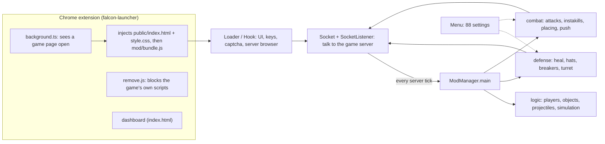

# How Falcon works, module by module

This guide explains each part of the mod and which menu settings switch it on. For the full list of
settings with their defaults, see [SETTINGS.md](SETTINGS.md).

## The big picture

1. The extension notices a `sandbox.moomoo.io` or `sandbox.moomodding.io` page loading. It replaces the page
   with Falcon's own page and runs the mod bundle (`falcon-launcher/src/background.ts`).
2. The mod connects to the game server (`core/socket`). Every message from the server goes through
   `SocketListener`, which updates what Falcon knows about the world.
3. The server sends a tick about every 111 ms. After each one, `ModManager.main` runs the whole "brain" in a
   fixed order (below) and sends the resulting packets.
4. Every module reads its own menu setting on every tick, so switching a setting on or off mid-fight takes
   effect on the next tick.

All paths below are inside `mod-source/src/`.

## The tick, in order (`core/ModManager.ts`)

The order matters. Damage and knockback predictions rely on the order in which the server updates players
(see [GOLD_TECH.md](../GOLD_TECH.md)), so don't reorder these steps.

1. **Prepare**: rebuild this tick's state: players, nearby objects, predicted positions and object damage
   queued from the last tick.
2. **DefenseSystem.start**: add up the damage we could take this tick (spikes, enemies, projectiles).
3. **Attack side**: AutoPusher, then AttackManager (picks one attack from the attack modules), then
   CombatController.
4. **DefenseSystem.respond**: heal, and decide whether a soldier or EMP helmet is still allowed, knowing what
   the attack side wants to do.
5. **DefenseSystem.resolve and PlacementSystem**: send this tick's hat, movement and placement packets.
6. **Clean up**: hand the packet budget to the next tick.

While you're dead the tick doesn't run at all (`Client.isAlive`).

## Attack modules (`core/mod/combat/modules`)

Each one is a `ModModule` (`core/mod/utils/ModModule.ts`): `init` once, `update` every tick, `run` when it may
act, and `reset` when you respawn. `AttackManager` runs them in list order and uses the best attack they
offer.

| Module | Settings | What it does |
|---|---|---|
| AntiBuller | `antiBull`, `forceAntiBull` | Counters bull-helmet spam with Spike Gear and Corrupt X Wings. |
| AutoInstakiller | `attackFactoringKB:insta`, `…:allowInTrap` | Instakills when the knockback simulation says it lands. |
| AutoAttacker | `attackFactoringKB:hits` | Normal hits that take knockback into account. |
| ProjectileSyncer | `projectileSync` | Attacks the moment a one-tick with a projectile is possible. |
| AutoPushStriker | `attackInPush` and its method settings | Attacks during an auto push once the enemy touches a spike (shame strike, predictive or bull spam, by weapon). |
| TurretAPAssister | `turretBulletAssistOnAP` | Uses turret gear on a pit-spiked enemy when nothing else can attack. |
| VelocityAttacker | `velocityHits` | Hits enemies who are about to run into spikes. |
| DefensiveKnockbacker | `defensiveKB`, `defKBRequireTurret` | Knocks enemies away from you for defence. |
| AutoMeleeSyncer | `meleeSync`, `meleeSyncTarget` | Attacks together with a Falcon ally on the same target. |
| TurretGearKnockbacker | `turretGearKB` | Uses turret gear's knockback when it kills. |
| BarbarianKnockbacker | `barbKnockback` | Uses barbarian armour when its knockback kills. |
| AppleInstakiller | `appleInsta` and its options | Breaks the enemy's trap and one-shots them with a spike. |
| SpikeTicker | `spikeTick` | Spike instakill when a trap breaks. |
| OneTicker | `dynamicOneTick`, `oneTickIgnoreHats` | One-ticks whenever the numbers say it kills. `T` toggles tap mode. |

## Combat core (`core/mod/combat/core`)

| System | Settings | What it does |
|---|---|---|
| AttackManager | none | Runs the attack modules and keeps the chosen attack sequence. |
| AutoPusher | `autoPush`, `autoPushRange` | Moves to push enemies into spikes, using the pathfinder. |
| CombatController | `selectBestWeapon` | Chooses weapon, hat and accessory for the current attack mode. |
| PlacementSystem | `autoPlacing`, `autoPlaceRange` | Sends placement packets for the best angles found. |

## Placing (`core/mod/combat/placing`)

- **AngleFinder** works out every free angle around you where an item fits, then scores them with the
  graders (`grader-modules`: SpikeGrader, TrapGrader). `angleFinderLevel` sets how many angles it tries.
- **AutoPlacer**, **AutoReplacer** and the preplacer place traps and spikes on the best angles
  (`preplacer`, `replacer`, `twoTickPlacements`).
- **AutoGrinder** (`autoGrind`, `grindPrimaryLimit`, `grindSecondaryLimit`) places and breaks buildings to
  level up weapons, and switches itself off once both weapons reach the chosen variant. **AutoMiller**
  places windmills behind you while you walk, until you reach the sandbox limit.

## Defense (`core/mod/defense`)

| System | Settings | What it does |
|---|---|---|
| DefenseSystem | `defensiveHatSwitching`, `usePatternRec` | Adds up incoming damage each tick and decides how to respond. Pattern recognition learns enemies' spike-tick habits. |
| AutoHealer | `autoHeal` | Eats food when the predicted damage needs it. |
| HatSystem | `antiBull` and others | Picks the hat and accessory for the tick (soldier, EMP, flipper in the river, winter cap in snow, booster when moving...). |
| MovementManager | `safeWalk` and its options | Stops you walking into spikes and other dangerous buildings. |
| AutoBreaker | `autoBreak` | Breaks out of traps, choosing the spike to break and when to use tank gear. |
| ObjectBreaker | `walkBreaker`, `objectBreaker:pit_spike` | Breaks spikes, traps and teleporters near you. |
| TurretManager | none | Tracks turret reloads for every player. |

## World tracking (`core/logic`)

- **PlayerManager** and the player managers in `players/core`: positions, weapons, reloads and predicted
  states of every player.
- **ObjectManager** and **ObjectPool**: every building and resource, split into chunks so nearby objects are
  quick to find. **PotentialObjectManager** tracks buildings that are probably about to appear.
- **ProjectileManager**: arrows and turret shots, and who fired them.
- **TextManager**: floating damage numbers.

## Simulation (`core/mod/simulation`)

**MovementPhysicsSimulator** predicts where players end up after hits and knockback, including collisions with
buildings and spikes. Attack and defense modules use it to check whether an action kills or saves you.

## Connection (`core/socket`, `core/utils`)

- **Socket**: the WebSocket to the game server, including the v1.9.0 packet cipher.
  **LegacyPacketAdapter** converts moomodding.io v1.8.2 packets to the v1.9.0 layout.
- **SocketListener**: one handler per server packet.
- **PacketBatcher**: groups packets that arrive together, and fakes a tick when one is late (not while dead).
- **PacketTracker**: the packets-per-second budget (`packetBudgetLimit`, `packetBudgetStrictness`), so Falcon
  never sends more than the server allows.
- **CaptchaManager**, **ProtocolLoader**: joining a server (Cloudflare Turnstile on moomoo.io).
- **ChatCommands**: `!` commands typed in chat (`!plog` saves a packet log).

## Interface (`ui`, `core/menu`, `rendering`)

- **Loader** and **Hook**: build the page, read keys and mouse. **ServerBrowser**: the server list.
- **Menu** (`core/menu`): the settings window. The settings themselves are plain data in `core/menu/content`
  (one file per tab). Settings are saved in `localStorage` with a version number (`settingsVersion.ts`), so
  old saves are upgraded or safely skipped.
- **rendering**: draws the game on the canvas: players, buildings, names, placement markers and overlays.

## Services (`services`)

- **Pathfinder**: finds paths in a background worker (used by AutoPusher).
- **PacketRecorder**: keeps the last ~15 seconds of packets so a `.fpl` log can be saved on death or with
  `!plog`. **PacketReplayer** (`core/PacketReplayer.ts`) plays such a log back.
- **Http**: network requests with timeouts and retries.
- **Profiler**: per-step timings, in development builds only (`npm run dev` or `npm run bench`).

## Extension (`falcon-launcher`)

- **background.ts**: injects Falcon into game pages and remembers how the last load went.
- **gameLoader.ts**: the page-side steps (replace the page, start the client, show an error box if it fails).
  The Quick Inject build reuses them.
- **remove.js**: stops the game's own scripts from running.
- **dashboard**: status, setup guide and troubleshooting (`index.html`, `src/dashboard.ts`).
